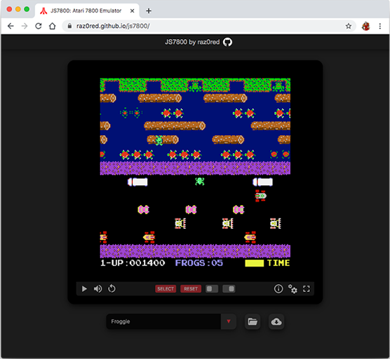

# JS7800

Ported by raz0red

JS7800 is an enhanced JavaScript port of the ProSystem Atari 7800 emulator that was originally developed by Greg Stanton.

https://raz0red.github.io/js7800/

In order to operate correctly and smoothly (no lags, etc.), JS7800 requires an updated version of a modern browser (Chrome, Firefox, Safari) on a capably configured system.

## Features

* Global high score tracking (for HSC compatible games)
* Customizable keyboard mappings
* Gamepad compatibility (with dual-analog support for Robotron-style games)
* Full screen support
* Multiple aspect ratios
* Ability to enable/disable video filters
* Drag and drop support for local files and remote file links
* Cartridge list support (see [JS7800 Wiki](https://github.com/raz0red/js7800/wiki/Cartridge%20Lists))
* Light gun support (via mouse)
* Expansion Module (XM) support
* Enhanced bank switching and cartridge detection

## Future consideration

* Mobile support (virtual buttons, proper screen sizing, etc.)
  * (partially available in [webЯcade](https://www.webrcade.com))
* Paddle controller support (via mouse)
* Updating the emulation core to integrate accuracy and compatibility improvements that are part of the incredible [A7800 emulator](http://7800.8bitdev.org/index.php/A7800_Emulator)
* Save/load state support (available in [webЯcade](https://www.webrcade.com))
* Network-based multiplayer support
* Improved cartridge browser with detailed descriptions and screenshots (available in [webЯcade](https://www.webrcade.com))

## Documentation

JS7800 includes integrated documentation via the "Help/Information" button located in the commands bar directly below the emulator screen.

For information on the ["cartridge list"](https://github.com/raz0red/js7800/wiki/Cartridge%20Lists) format,  [request parameters](https://github.com/raz0red/js7800/wiki/Request%20Parameters), and more, refer to the [JS7800 Wiki](https://github.com/raz0red/js7800/wiki).

## Change log

### 11/05/26 (0.1.0)
    - DMA and timing accuracy rewrite (contributed by Mike Saarna)
        - MARIA DMA cycle penalties, holey DMA, and WSYNC/NMI timing
        - Slow TIA/RIOT/MARIA access cycle stretch
        - Racing-beam style rendering (display is drawn as the CPU runs)
        - Frame starts inside VBLANK
        - RIOT rewrite (timer, SWCHA/SWCHB and 1/2 button mode behavior)
        - Memory map: unmapped reads return open bus, TIA/MARIA/RAM mirrors, unmapped writes dropped
        - Undriven TIA bits float to the last value on the data bus
        - Undocumented 6502 opcodes (SLO, RLA, SRE, RRA, DCP, ISC, SAX, LAX, ARR, LAS, ANC, ALR, NOPs)
          with correct cycle counts
        - Mirror RAM at $4000 (cartridge header byte 54, bit 7)
    - Additional changes:
        - Stack pointer starts at $FD after reset. $0100-$013F is now a TIA/MARIA mirror, so carts
          that never set up a stack were pushing into registers (Asterix Quest hack, Ms. Pac-Man
          color hack)
        - Klax prototypes: bank 6 is mapped at $4000 on 128K SuperGame carts (the game draws its
          text from there)
        - High score cartridge: saved scores are restored directly to RAM (the new unmapped-write
          rules were dropping them)
        - Banksets: MARIA's half of the image is now half the cartridge size instead of a
          hardcoded 128K
        - Pokey: added the STIMER register ($4009)
        - Audio: sample queue is capped and the last sample is held on underrun (no clicks)
        - Advanced settings: "Force twin stick" option (session only, not saved) enables dual analog mode
          for any game. In dual analog mode, the gamepad right shoulder is button 1 and the left
          shoulder is button 2 (shoulders no longer pause)
    - Fixes since 0.0.9 (not previously listed):
        - Updated NTSC/PAL palettes for modern displays (contributed by Trebor)
        - LAX abs (Phoenix fix), SBX opcode
        - BCD subtraction aligned with A7800
        - 320D mode fix (reported by Playsoft)
        - ARTI and 2048 updates

### 01/25/24 (0.0.9)
    - Souper support
    - Activision OM ROM layout support
    - Pole Position II track selection fix (by RevEng @ AtariAge)
    - Tower Toppler and Jinks composite smoothing (by RevEng @ AtariAge)
    - Updated palettes (contributed by Trebor @ AtariAge)
    - Updated Popeye (JS7800 Demo 2.41) (contributed by darryl1970 @ AtariAge)

### 08/16/23 (0.0.8)
    - TIA fidelity issue fix (contributed by RevEng @ AtariAge)

### 08/13/23 (0.0.7)
    - Pokey rewrite (contributed by RevEng @ AtariAge)
    - RIOT interrupt mirror fix (contributed by RevEng @ AtariAge)
    - Added Drelbs homebrew
    - Added latest version of Arkanoid homebrew (now works due to RIOT fix)
    - Added several Pokey-based demos

### 08/10/23 (0.0.6)
    - Updated palettes (contributed by Trebor @ AtariAge)
    - YM-2151 default volume level adjustment
    - Cartridge header fix for television type

### 07/30/23 (0.0.5)
    - Banksets support
    - Maria background color fix (Keystone Koppers)
    - Cartridge headers fix (Fixes several ROMs that required special versions)
    - Improved cycle accuracy (resolves several game glitches)
    - YM-2151 homebrew auto-detect support
    - Pokey filter support (contributed by RevEng @ AtariAge)
    - Support for 7800 Diagnostic cartridge
    - Save state support (only accessible via webЯcade)
    - Added to default game list: IE78 (Demo), Bad Apple (Demo), Bankset Tests,
      Baby Pac-Man, 7800 Test, Keystone Koppers (Demo), Galaxian, PentaGo!
    - Updated several games to latest versions
    - Added high score support for: 1942, Galaxian, Keystone Koppers, PentaGo!,
      latest versions of games that were already supported.

### 01/05/21 (0.0.4)
    - Added global high score support for "Popeye"
    - Added global high score support for the latest version of "Pac-Man Collection!"
    - Updated to the latest versions of "Dragon's Cache", "Dragon's Descent", "Popeye",
      "Spire of the Ancients", "E.X.O", and "Knight Guy: Castle Days"

### 09/03/20 (0.0.3)
    - Added support for undocumented ASR and ANC opcodes (fixes graphical glitches with
      "Popeye 7800: Mini-game")
    - Added global high score support for the latest version of "Pac-Man XM"
    - Added "Popeye 7800: Mini-game" and "Knight Guy: Castle Days" to the default list of
      in-development games
    - Updated to the latest versions of "Dragon's Cache", "Dragon's Descent", "GoSub", and
      "Spire of the Ancients"
    - Updating to the latest version of "Dragon's Descent" required the global high scores for
      this game to be reset (the latest version modified the way high scores were stored)

### 06/18/20 (0.0.2)
    - XM implementation has been updated to be consistent with the released hardware
    - Initial support for the Yamaha (YM2151) sound chip
    - Ability to disable vertical sync ("Advanced" tab of settings dialog)
    - Zanac and Side-Crawler's Dance Yamaha music demos added to default cartridge list
    - XM memory test added to default cartridge list
    - By default, high scores for games that are not supported by the Global High Score server
      will be stored locally
    - Resolved defect where Global High Scores were not supported when local storage was disabled

### 05/26/20 (0.0.1)
    - Ability to select a color palette ("Cool", "Warm", and "Hot") in "Dark" and "Light" variations
    - "Fullscreen" scaling option (Integer vs. Fill)
    - "Global Leaderboard" page
    - Contextual launch of "Global Leaderboard" via controls bar

### 05/16/20 (0.0.0)
    - Initial release

